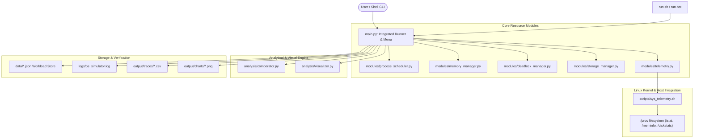
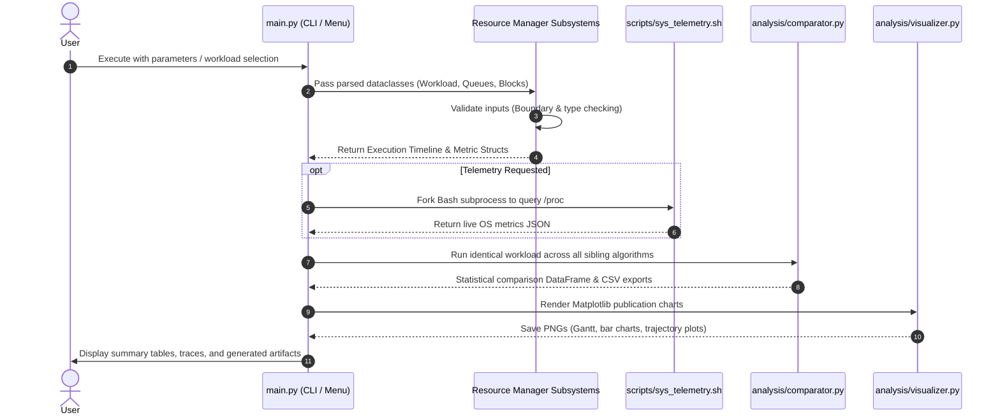

# Phase 1: System Design and Planning

**Module Title:** Operating System Resource Management Simulator  
**Marks Weightage:** 20 Marks  
**Submission Target:** Problem clarity, modular architecture, workflow, data design, and implementation plan.

---

## 1. Executive Summary & Problem Formulation
Operating systems are charged with governing physical and virtual hardware resources under strict constraints of performance, fairness, and safety. In traditional academic pedagogy, concepts such as CPU scheduling, contiguous/paged memory management, deadlock avoidance, and secondary storage seek optimization are often studied as isolated mathematical abstractions. 

This project designs and implements an **integrated, production-grade Operating System Resource Management Simulator** in Python with direct **Linux/Unix Bash kernel telemetry integration**. Rather than a disjoint set of standalone scripts, this application unifies the four major resource pillars of operating systems:
1. **CPU Process Scheduling Subsystem:** Multi-algorithm dispatcher (FCFS, Non-Preemptive SJF, Preemptive SRTF, Round Robin with configurable quantum, Priority Preemptive & Non-Preemptive, and 3-level Multi-Level Feedback Queue with starvation aging).
2. **Memory Management Subsystem:** Dual-mode memory engine comprising Contiguous Partition Allocation (First-Fit, Best-Fit, Worst-Fit with internal/external fragmentation tracking) and Virtual Memory Page Replacement (FIFO, LRU, Belady's Optimal, and LFU with Belady's Anomaly detection).
3. **Deadlock Management Subsystem:** Complete safety and resource-request engine implementing Dijkstra's Banker's Algorithm, Resource Allocation Graph (RAG) 3-color DFS cycle detection for single instances, and multi-instance deadlock detection with cost-optimized victim recovery.
4. **Storage / Disk Scheduling Subsystem:** Secondary storage head actuator simulator implementing FCFS, SSTF, SCAN (Elevator), C-SCAN, LOOK, and C-LOOK.
5. **Real OS Telemetry & Bash Subprocess Engine:** Interfaces directly with Linux `/proc/loadavg`, `/proc/meminfo`, and `/proc/diskstats` (or native `psutil`) via Bash to compare simulated metrics against real-world OS state.

---

## 2. Modular Architecture & Decomposition

The project enforces strict separation of concerns, loose coupling, and high cohesion:



---

## 3. Data Structures & State Representation

### 3.1 Process Control Block (`Process`)
```python
@dataclass
class Process:
    pid: str                      # Process Identifier (e.g. 'P1')
    arrival_time: int             # Ticks when process enters Ready Queue
    burst_time: int               # Total CPU execution ticks required
    priority: int = 0             # Priority level (lower = higher priority)
    remaining_time: int = 0       # Dynamic ticks remaining until completion
    start_time: Optional[int]     # Tick when process was first dispatched
    completion_time: int = 0      # Tick when process terminated
    waiting_time: int = 0         # Turnaround Time - Burst Time
    turnaround_time: int = 0      # Completion Time - Arrival Time
    response_time: int = -1       # First Start Time - Arrival Time
```

### 3.2 Contiguous Memory Block (`MemoryBlock`)
```python
@dataclass
class MemoryBlock:
    block_id: int                 # Physical partition ID
    size: int                     # Total capacity in bytes
    start_address: int            # Physical base address
    allocated_to: Optional[str]   # Process PID holding block
    allocated_size: int = 0       # Exact bytes occupied by process
    
    # Internal fragmentation = size - allocated_size (when allocated)
```

### 3.3 Banker's Algorithm State (`BankersState`)
- $\text{Available}[j]$: Vector of length $m$ representing available units of resource type $R_j$.
- $\text{Max}[i][j]$: Matrix of size $n \times m$ defining maximum demand of process $P_i$ for resource $R_j$.
- $\text{Allocation}[i][j]$: Matrix of size $n \times m$ defining resources currently allocated to $P_i$.
- $\text{Need}[i][j] = \text{Max}[i][j] - \text{Allocation}[i][j]$: Remaining resources needed by $P_i$.

### 3.4 Resource Allocation Graph (`ResourceAllocationGraph`)
- Formally defined as $G = (V, E)$, where $V = P \cup R$.
- Request edge $P_i \to R_j$: directed edge from process to resource indicating pending claim.
- Assignment edge $R_j \to P_i$: directed edge from resource to process indicating resource holding.

### 3.5 Disk Head Request (`DiskSchedulingResult`)
- Sequence of requested cylinder coordinates: $[c_1, c_2, \dots, c_k]$.
- Head traversal order: $[h_0, c_{\pi(1)}, c_{\pi(2)}, \dots, c_{\pi(k)}]$.
- Total head movement: $\sum_{i=1}^{k} |h_i - h_{i-1}|$.

---

## 4. Input / Output Flow & Control Pipeline



---

## 5. Implementation Roadmap & Milestones
- **Milestone 1 (Design & Setup):** Formulate data models, package layout, logging pipeline, and workload schemas in JSON.
- **Milestone 2 (Core Modules):** Implement scheduling algorithms, memory partition & replacement engines, Banker's & RAG graph algorithms, and disk elevator models.
- **Milestone 3 (Bash Integration):** Develop Linux kernel telemetry collector via Bash and dual-path fallback via `psutil`.
- **Milestone 4 (Analysis Engine):** Construct cross-algorithm benchmark tables and Matplotlib visualization pipelines.
- **Milestone 5 (Reliability & Testing):** Write 40+ unit, boundary, and negative test cases verifying zero unhandled exceptions and complete activity logs.
